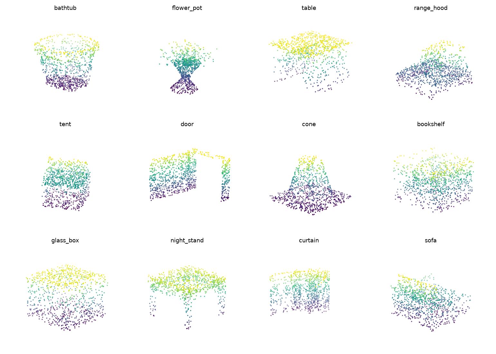
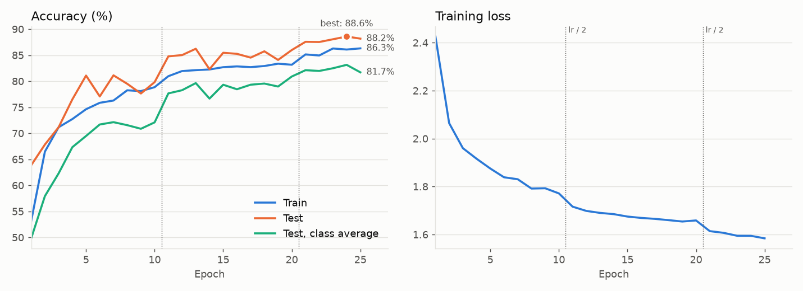
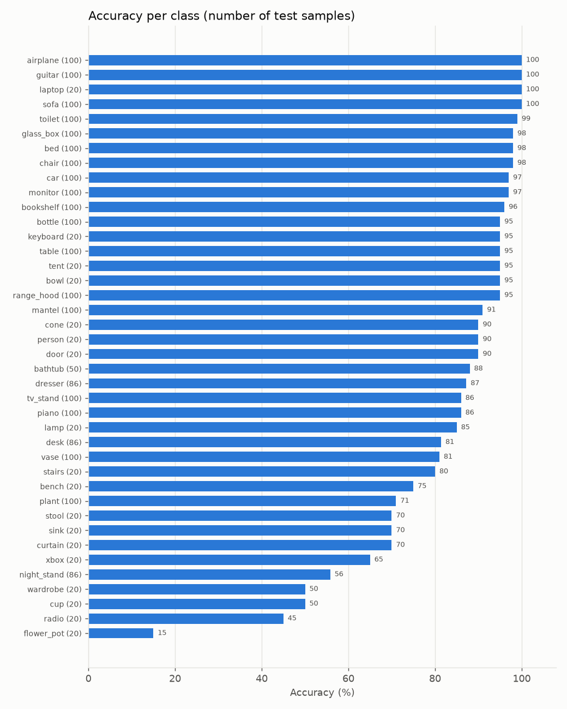
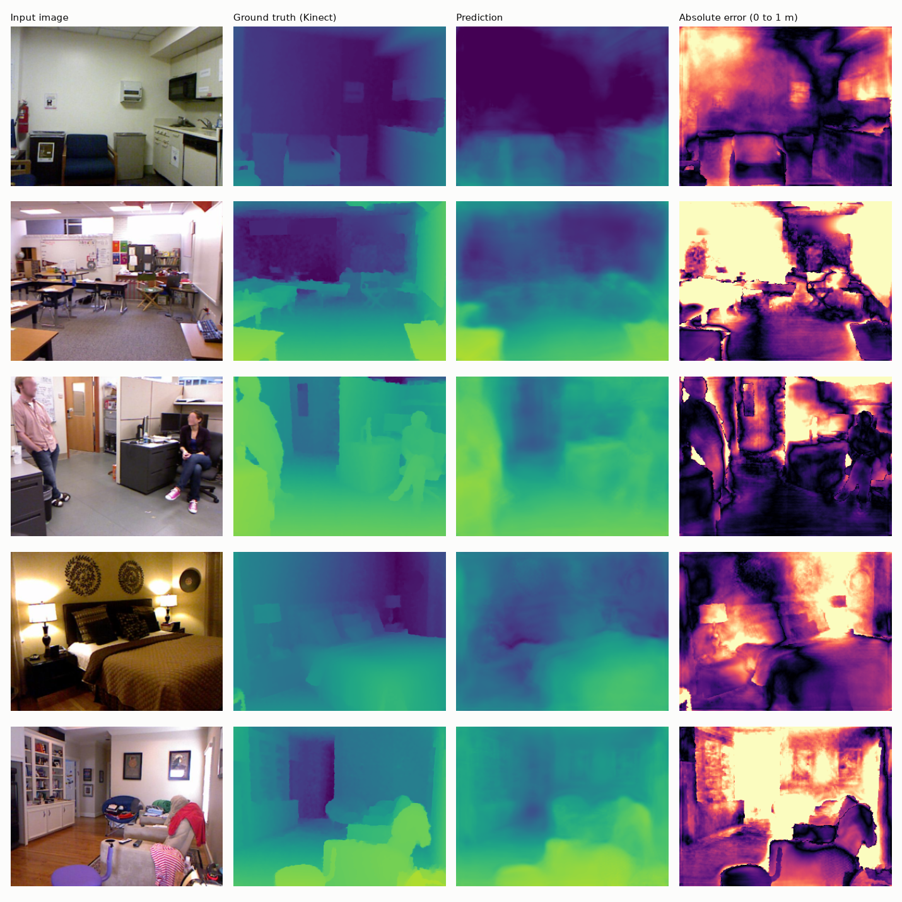
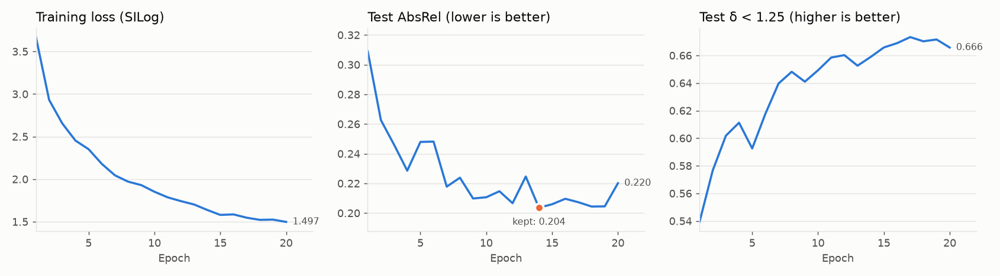

# 3D Perception with Deep Learning

Teaching a machine to understand the world in 3D: recognizing objects from point clouds, estimating depth from a single image, and detecting objects in a LiDAR scene.

The project goes from a single object to a full street scene in three steps:

| Step | Task | Data | Status |
|---|---|---|---|
| 1 | Point cloud classification (PointNet) | ModelNet40 | Done, **88.6%** |
| 2 | Monocular depth estimation (U-Net) | NYU Depth v2 | Done, **AbsRel 0.204** |
| 3 | 3D object detection in LiDAR scans | KITTI | Planned |

## Step 1: PointNet on ModelNet40



ModelNet40 contains 12,311 3D models across 40 classes (airplane, chair, table, guitar...). Each mesh is turned into a cloud of 1,024 points sampled uniformly on its surface, then centered and scaled into the unit sphere.

PointNet ([Qi et al., CVPR 2017](https://arxiv.org/abs/1612.00593)) reads these points directly, without turning them into images or voxels. The same small network processes every point on its own, then a max-pooling summarizes the whole set: the result does not depend on the order of the points, which is checked in the tests.

### Results

| | Overall accuracy | Class average |
|---|---|---|
| This project (25 epochs, CPU, no 64x64 T-Net) | **88.6%** | 83.1% |
| Original paper (250 epochs, GPU, full model) | 89.2% | 86.2% |

The model gets within 0.6 points of the paper with ten times fewer epochs, trained in 5 hours on an Intel i3 laptop CPU with no GPU.



The jumps at epochs 11 and 21 match the points where the learning rate is halved. Test accuracy stays above training accuracy because training uses augmented data (scaling, shifting, noise) and dropout, while the test runs on the raw clouds.

### Where the model gets it wrong



The errors are not random. They focus on objects that have almost the same shape:

| True class | Predicted as | Share of samples |
|---|---|---|
| flower_pot | plant | 55% |
| cup | vase | 30% |
| radio | glass_box | 25% |
| wardrobe | bookshelf | 25% |
| night_stand | dresser | 22% |

A flower pot almost always holds a plant, and a night stand looks a lot like a smaller dresser. Since every cloud is scaled to the same size, the real size of the object is lost, and that is exactly what tells these classes apart. The weakest classes also have only 20 test samples, so a single mistake costs 5 points.

The full confusion matrix is in [docs/pointnet_confusion.png](docs/pointnet_confusion.png) and the per-class numbers in [docs/pointnet_results.json](docs/pointnet_results.json).

### Reproduce

```bash
conda env create -f environment.yml
conda activate perception
pip install open3d   # optional, for the interactive 3D view

# ModelNet40.zip (1.9 GB): http://modelnet.cs.princeton.edu, unzip into data/raw/
python scripts/prepare_modelnet40.py
python scripts/train_pointnet.py --epochs 25 --lr-step 10 --no-feature-transform
python scripts/evaluate_pointnet.py
```

An interrupted run continues with `--resume`. On a GPU, the full model (without `--no-feature-transform`) over 250 epochs follows the paper's setup.

## Step 2: Depth from a single image on NYU Depth v2

A normal camera gives colors, not distances. The goal here is to predict, for every pixel of a single RGB photo, how far it is from the camera in meters.

NYU Depth v2 contains indoor scenes filmed with a Kinect, which measures the real depth. The labeled subset has 1,449 images with the official split: 795 for training, 654 for testing. The images are cropped to remove the calibration border and resized to 240x320.

The model is a U-Net. A ResNet-18 encoder pretrained on ImageNet reads the image, and a decoder rebuilds a full-resolution depth map, reusing the encoder features at each scale through skip connections. The encoder is trained with a learning rate 10x lower than the decoder so it keeps what it learned on ImageNet. The loss is the scale-invariant log loss from Eigen et al.: it focuses on the relative depth between pixels, which is what a single image can really tell.



### Results

Standard NYU metrics on the 654 test images (AbsRel and RMSE: lower is better, δ: share of pixels within 25%, 56% and 95% of the true depth):

| | Training images | AbsRel | RMSE | δ < 1.25 | δ < 1.25² | δ < 1.25³ |
|---|---|---|---|---|---|---|
| This project (20 epochs, CPU) | 795 | **0.204** | **0.696 m** | **65.9%** | **90.8%** | **97.7%** |
| [Eigen et al., NIPS 2014](https://arxiv.org/abs/1406.2283) | ~120,000 | 0.215 | 0.907 m | 61.1% | 88.7% | 97.1% |
| [DenseDepth, 2019](https://arxiv.org/abs/1812.11941) | ~50,000 | 0.123 | 0.465 m | 84.6% | 97.4% | 99.4% |

With 150 times fewer training images than Eigen et al., the model does better on every metric, mostly thanks to the pretrained encoder. The numbers are measured at 240x320 instead of the full 480x640, so the comparison gives an order of magnitude rather than an exact ranking. DenseDepth shows where the same idea goes with a bigger encoder and a lot more data.



The model kept is the one from epoch 14, with the lowest test AbsRel.

### What the examples show

- The overall layout is right in every scene: the floor gets closer toward the bottom of the image, walls and back of the room are far.
- Close objects with clear edges (people, chairs, beds) come out well, which is visible in the dark areas of the error maps.
- The predictions are blurrier than the Kinect, and thin details (chair legs, shelves) are lost.
- A large part of the error comes from a global scale shift: in some rooms the whole scene is predicted a bit too close or too far. From one photo, a small room and a large room can look the same, and the scale-invariant loss by design does not push hard on absolute scale. That is the main limit of monocular depth, and the reason why cars and robots add a LiDAR or a stereo camera.

### Reproduce

```bash
# nyu_depth_v2_labeled.mat (2.8 GB) and splits.mat: http://horatio.cs.nyu.edu/mit/silberman/
# put both files in data/raw/nyu/
python scripts/prepare_nyu.py
python scripts/train_depth.py --epochs 20
python scripts/evaluate_depth.py
```

## Project structure

```
src/perception/
  datasets/modelnet.py   .off reader, surface sampling, PyTorch Dataset
  datasets/nyu.py        NYU Depth v2 extraction and Dataset
  models/pointnet.py     PointNet, T-Net and regularization
  models/depth_unet.py   U-Net with a pretrained ResNet-18 encoder
  metrics.py             depth loss and NYU metrics
scripts/                 data preparation, training, evaluation, visualization
tests/                   unit tests (pytest)
docs/                    figures and results
```

## Tests

```bash
pytest
```

Among other things, the tests check that the PointNet prediction does not change when the points are shuffled, that it can memorize a small batch, that the depth metrics ignore pixels without a Kinect measurement, and that the depth loss with λ = 1 does not penalize a global scale error.
